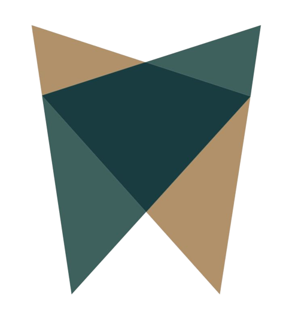
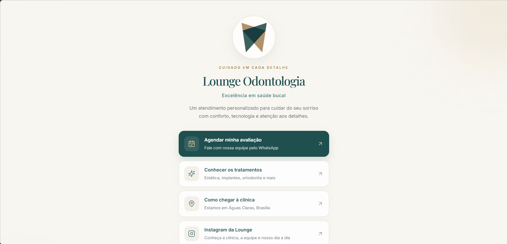

<div align="center">

  

  <h1>Lounge Odontologia — Link da Bio</h1>

  <p><strong>Uma experiência digital elegante, simples e pensada para facilitar o contato com a clínica.</strong></p>

  <p>
    
    
    
  </p>

  <p>
    <a href="https://www.loungeodontologia.com.br/">Site institucional</a>
    ·
    <a href="https://instagram.com/loungeodontologia">Instagram</a>
    ·
    <a href="https://wa.me/5561996263616">Agendar pelo WhatsApp</a>
    .
    <a href="https://loungeodontologia.vercel.app/">Acessar links</a>
  </p>

</div>

---

## Visão geral

O **Lounge Odontologia — Link da Bio** é uma página de acesso rápido aos principais canais da clínica. Desenvolvida para funcionar como destino do link da bio em redes sociais e em comunicações digitais, ela reúne os caminhos mais importantes para quem deseja conhecer a clínica, consultar tratamentos ou iniciar um agendamento.

A interface utiliza uma identidade visual premium, com tons de verde-petróleo, marfim e dourado suave, priorizando legibilidade, navegação intuitiva e uma experiência consistente em dispositivos móveis.

## Prévia da interface

<div align="center">
  
  <p><em>Prévia da página de links — layout desktop.</em></p>
</div>

> **Imagem:** a captura acima está armazenada em `public/print.png`. A logo usada no cabeçalho deste README deve estar em `public/logo.png`.

## Objetivos do projeto

- Facilitar o agendamento de avaliações pelo WhatsApp.
- Reunir os principais canais digitais da clínica em um único endereço.
- Apresentar a marca de forma elegante, coerente e profissional.
- Oferecer uma navegação rápida, acessível e adaptada a telas menores.
- Direcionar o visitante para o site institucional, localização e perfis oficiais.

## Links disponíveis

| Ação | Finalidade |
| --- | --- |
| **Agendar minha avaliação** | Inicia uma conversa com a equipe pelo WhatsApp. |
| **Conhecer os tratamentos** | Direciona para o site institucional da clínica. |
| **Como chegar à clínica** | Abre a localização da Lounge Odontologia no Waze. |
| **Instagram da Lounge** | Acessa o perfil da clínica. |
| **Instagram do Dr. Murilo** | Direciona ao perfil profissional do dentista. |

## Identidade visual

A apresentação visual foi pensada para transmitir cuidado, confiança e sofisticação sem comprometer a clareza dos conteúdos.

| Elemento | Aplicação |
| --- | --- |
| Verde-petróleo `#1F4F4F` | Cor principal e chamada de agendamento. |
| Dourado `#C4A574` | Detalhes, ícones e acentos visuais. |
| Verde-azulado `#4A7C7E` | Ícones e elementos de apoio. |
| Marfim `#F8F6F1` | Fundo principal da página. |
| Playfair Display | Tipografia de destaque. |
| Inter | Tipografia de interface e leitura. |

## Tecnologias

- **React** — composição da interface em componentes.
- **TypeScript** — tipagem estática e maior previsibilidade do código.
- **Vite** — ambiente de desenvolvimento e build.
- **Tailwind CSS** — estilização responsiva.
- **Lucide React** — ícones da interface.
- **Vercel** — hospedagem e publicação contínua, conforme a configuração do projeto.

## Estrutura relevante

```text
Lounge-Link-Novo/
├── client/
│   ├── public/
│   │   ├── logo.png
│   │   └── print.png
│   ├── src/
│   │   └── pages/
│   │       └── Home.tsx
│   └── index.html
└── README.md
```

> Ajuste os caminhos do exemplo caso a estrutura real do repositório seja diferente. A captura de tela deve ficar em `client/public/print.png` se o diretório `public` estiver dentro de `client`; nesse caso, atualize o caminho da imagem neste README para `client/public/print.png`.

## Executar localmente

Os comandos abaixo devem ser executados no diretório que contém o `package.json` da aplicação.

```bash
# Instalar as dependências
npm install

# Iniciar o servidor de desenvolvimento
npm run dev

# Gerar a versão de produção
npm run build
```

Para conferir os scripts e a versão de Node recomendada, consulte o `package.json` do projeto.

## Publicação

O projeto pode ser publicado na Vercel conectado ao repositório GitHub. Em uma configuração com deploy automático, commits enviados à branch configurada iniciam uma nova publicação.

Antes de divulgar o endereço:

1. Confirme o domínio de produção nas configurações da Vercel.
2. Teste todos os links em um celular.
3. Verifique se o botão de WhatsApp abre a conversa com a mensagem esperada.
4. Confirme se os perfis de Instagram estão corretos.
5. Revise os metadados de compartilhamento e o endereço canonical em `client/index.html`.

## Escopo e manutenção

Este repositório é dedicado à página de links da Lounge Odontologia. **Alterações neste projeto não devem modificar o site institucional** `www.loungeodontologia.com.br`, que é mantido separadamente.

Ao atualizar os links, confira os endereços oficiais antes da publicação. Evite incluir informações clínicas ou dados pessoais de pacientes nesta página.

## Marca

**Lounge Odontologia**  
Excelência em saúde bucal  
Águas Claras · Brasília, DF

- Site: https://www.loungeodontologia.com.br/
- Instagram: https://instagram.com/loungeodontologia
- WhatsApp: https://wa.me/5561996263616

---

<div align="center">
  <p>Créditos e Direitos</p>

<span>Desenvolvido por Salas Tech.</span>

© 2026 Lounge Odontologia. Todos os direitos reservados.
</div>
